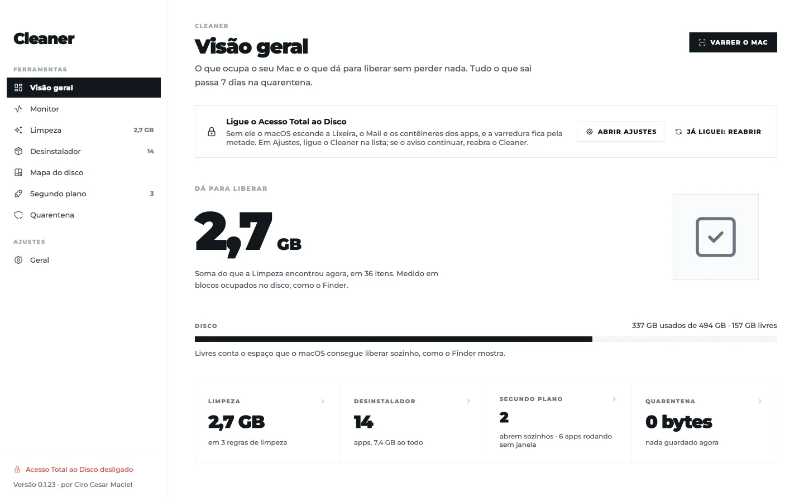
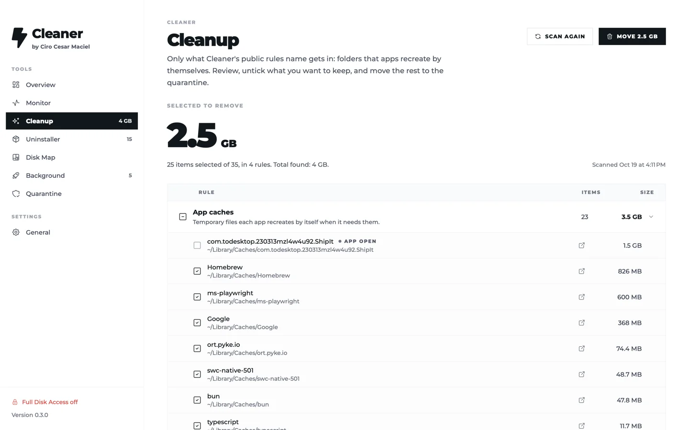
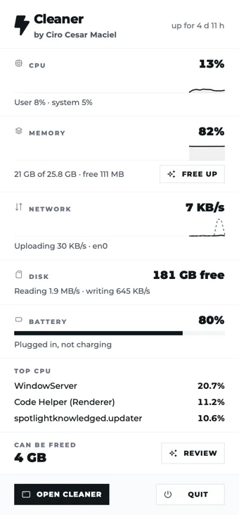

# Cleaner by Ciro Cesar Maciel

**O limpador de Mac que mostra tudo antes de apagar qualquer coisa.**

Toda regra que ele usa para limpar está num arquivo que dá para ler, o [`rules.json`](rules.json). Nada some na hora: o que você remove passa 7 dias numa quarentena e volta ao lugar com um clique. App nativo em Swift, para macOS 14 ou mais novo com Apple Silicon, sem nenhum código de rede.

[English](README.md)



## Instalar

```bash
curl -fsSL https://blob.ciromaciel.click/tools/cleaner/install.sh | bash
```

O script baixa o `.dmg` mais recente, copia o Cleaner para `/Applications` e abre o app.

Prefere a imagem de disco? [Baixe o Cleaner-macos.dmg](https://blob.ciromaciel.click/tools/cleaner/latest/Cleaner-macos.dmg). O Cleaner ainda não é notarizado pela Apple, então o macOS bloqueia o download pelo navegador na primeira vez. Libere uma vez:

```bash
xattr -dr com.apple.quarantine /Applications/Cleaner.app
```

Para a varredura completa, ligue o Cleaner em **Ajustes do Sistema → Privacidade e Segurança → Acesso Total ao Disco**. Sem isso, o macOS esconde a Lixeira, o Mail e os contêineres dos apps, e o Cleaner avisa em vez de fingir que viu tudo.

## Por que mais um limpador de Mac

Os limpadores conhecidos pedem que você confie num número de "lixo". O Cleaner mostra de onde vem esse número:

- **As regras são públicas.** O `rules.json` lista cada pasta que o Cleaner olha, por que é seguro limpar e o que fica de fora. Se uma regra estiver errada, você lê e pode mandar a correção.
- **Nada some.** Remover move os itens para um lote da quarentena que guarda o caminho de origem. Devolver é um clique; depois de 7 dias o lote se apaga sozinho.
- **Remover pede segurar o botão por 3 segundos.** Sem clique por engano.
- **Ele diz o que não consegue fazer.** Quando o macOS recusa um item, o Cleaner diz por quê:
  - item do sistema (`EACCES`): pede a senha de administrador uma vez por ação, num pedido que diz o que vai fazer e com quais itens;
  - item protegido (`EPERM`, como Lixeira, Mail, contêineres sem Acesso Total ao Disco ou itens do SIP): nunca pede senha, porque senha não resolveria. O item fica no lugar, e o aviso leva aos Ajustes.



## O que ele faz

| Tela | O que faz |
| --- | --- |
| Visão geral | Uma varredura para tudo: espaço que dá para liberar, disco, apps, inicialização, quarentena |
| Limpeza | Aplica as regras do `rules.json`: caches, registros, Lixeira, instaladores, Xcode, caches de desenvolvimento, anexos do Mail |
| Desinstalador | Lista os apps com tamanho e último uso; remove o app e os restos dele em 38 lugares, recibos de .pkg incluídos |
| Mapa do disco | Mede uma pasta inteira em paralelo e deixa entrar nas maiores |
| Inicialização | Liga e desliga LaunchAgents e LaunchDaemons sem apagar o arquivo |
| Quarentena | Lotes com o caminho de origem; devolve com um clique; apaga sozinho depois de 7 dias |
| Barra de menus | Processador, memória, rede, disco e bateria ao vivo, e quanto dá para liberar agora |



## A desinstalação completa

Em `Sources/Cleaner/Engine/Uninstaller.swift`, nesta ordem:

1. para os processos que rodam de dentro do app (extensões, ajudantes);
2. descarrega os agentes de inicialização;
3. tira o registro do app no macOS (LaunchServices);
4. move tudo para um lote da quarentena, limpando o cache do `cfprefsd` para os `.plist` não renascerem;
5. tira o ícone do Dock;
6. confere o que ficou.

Os restos são procurados em 38 lugares (`AppCatalog.places()`), pelo identificador do app ou pelo nome exato, inclusive pastas do fabricante e os recibos de `.pkg`. Devolver da quarentena refaz o registro e o ícone no Dock.

## Compilar

Precisa das Command Line Tools do Xcode. O Xcode inteiro é opcional.

```bash
git clone https://github.com/ciro-maciel/cleaner.git
cd cleaner
scripts/build.sh                 # dist/Cleaner.app
open dist/Cleaner.app
```

O `scripts/signing-identity.sh` cria, uma vez, um certificado local de assinatura. Com ele, o Acesso Total ao Disco continua valendo depois de cada build; sem ele, o build sai com assinatura ad hoc e o macOS pede a permissão de novo toda vez.

Os testes rodam no seu Mac sem mudar nada:

```bash
CLEANER_NO_ADMIN=1 dist/Cleaner.app/Contents/MacOS/Cleaner --selftest   # só lê; a quarentena roda numa pasta temporária
dist/Cleaner.app/Contents/MacOS/Cleaner --uninstall-test                # cria um app falso com todos os rastros, remove, confere e devolve
dist/Cleaner.app/Contents/MacOS/Cleaner --screenshots /tmp/shots        # captura todas as telas
```

`scripts/dist.sh` sobe o patch da versão, gera o `.dmg` e instala em `/Applications`. `bun scripts/assets.mjs` regera fontes, ícones e o ícone do app.

## Como é feito

- Swift e SwiftUI, compilado com `swiftc`, sem projeto do Xcode. Alvo: macOS 14 ou mais novo, Apple Silicon.
- Varredura com `fts(3)`, contando blocos ocupados no disco, em paralelo por pasta.
- Visual do design system Zen: rampa de cinzas, Montserrat, raio zero, ícones Tabler com traço 1,5.

## Limites

- Só Apple Silicon e macOS 14 ou mais novo.
- A interface está em português.
- Ainda não é notarizado, então o `.dmg` baixado pede a linha do `xattr` acima.
- Itens protegidos pelo SIP ficam onde estão. É o macOS funcionando como deve.
- Não procura duplicados, não faz varredura de malware e não atualiza apps.

## Contribuir

Issues e pull requests são bem-vindos, principalmente no `rules.json`. Veja o [CONTRIBUTING.md](CONTRIBUTING.md).

## Licença

[MIT](LICENSE). Fontes e ícones mantêm as próprias licenças: veja o [NOTICE](NOTICE).

---

Feito por [Ciro Cesar Maciel](https://ciromaciel.click/?ref=oss-cleaner). Eu faço ferramentas e mostro como usar: mais [ferramentas grátis](https://ciromaciel.click/tools?ref=oss-cleaner) e [apps de Mac](https://ciromaciel.click/tools/cleaner?ref=oss-cleaner).

**Quer a próxima?** [Siga @ciro-maciel](https://github.com/ciro-maciel) para as próximas ferramentas abertas, e clique em **Watch → Custom → Releases** aqui em cima para saber de cada regra nova do Cleaner.
